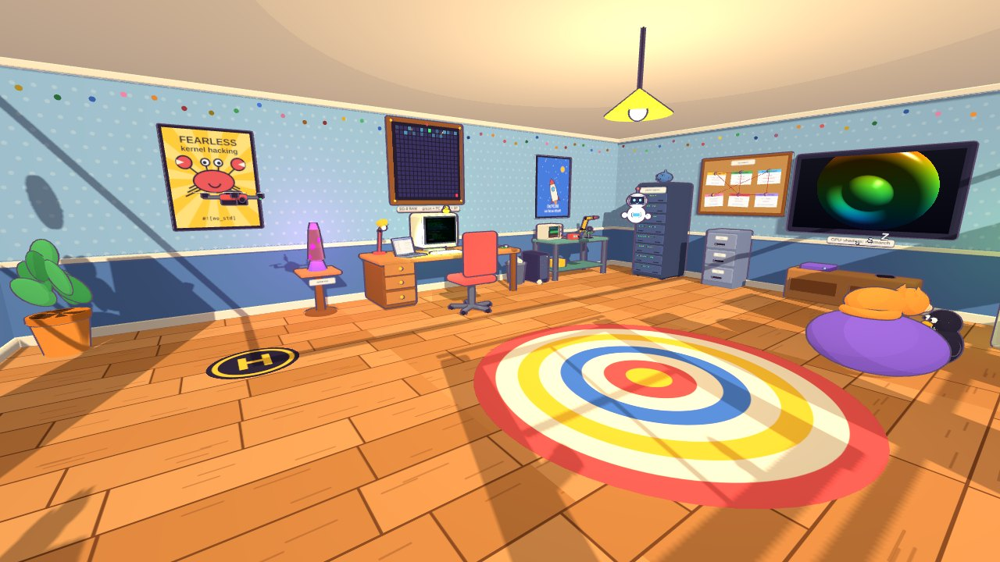

# Introduction

I started as a Roblox/Game developer. However, over time I got interested in Fullstack, Cybersecurity, Operating Systems, AI and Embedded Systems.

I also have a passion for low-level programming, which started when I began building my experimental operating system using Rust and C.

[SecureOS](https://github.com/EngineGames-Development/SecureOS)

---

# The Engine Room

An interactive cartoon 3D room built with **three.js** that is made out of my interests. Walk around (`WASD` + mouse, or touch on a phone) and use things with `E`:

* **A real 8-bit CPU (EG-8)** with an assembler and disassembler, driving LEDs, a robot arm, an oscilloscope and a live RAM board
* **SecureRustOS terminal** on a CRT: boot sequence, GDT encoder, memory map, `make run`, SQL / MongoDB queries
* **Reverse engineering:** a Ghidra-style crackme on the laptop · **Security:** packet capture with real IPv4 checksums, antivirus scan, password vault
* **Optical entropy** from a lava-lamp shader (von Neumann + SHA-256), a soldering station, a Packet Catcher arcade game, Tux jokes and 15 quests

**[Enter the room](https://enginegames-development.github.io/enginegames-development/room/)** · [source](room) · [design prompt](Prompt.MD)

---

# What I'm Working On

* **Fullstack:** Building my own password manager (work in progress): [EngineManager](https://github.com/EngineGames-Development/EngineManager),

  Vibecoding an AI assistant called: [EngineBuddy](https://github.com/EngineGames-Development/EngineBuddy)

* **Operating Systems & Low-Level:** Building my own OS, including the bootloader, kernel, drivers, x86 assembly, C/C++, Rust, etc.

  Old / discontinued OS: [SecureOS](https://github.com/EngineGames-Development/SecureOS)

  New OS (coming up):    [SecureRustOS](https://github.com/EngineGames-Development/SecureRustOS)

* **Cybersecurity & Reverse Engineering:** Learning reverse engineering with Ghidra, IDA Pro and other tools. I also work with tools such as Wireshark and Nmap.

  Own antivirus project: [Engine's Antivirus](https://github.com/EngineGames-Development/Engine-s-Antivirus)

* **AI & Embedded Systems:** I enjoy building projects with Arduino and Raspberry Pi, as well as experimenting with AI.

  Entropy / Computing project: [Hybrid-Entropy-Computing-Platform](https://github.com/EngineGames-Development/Hybrid-Entropy-Computing-Platform)

---

# The Tech Stack

| Technology              | Technologies & Languages                                             |
| :---------------------- | :------------------------------------------------------------------- |
| **Languages**           | `Python`, `JavaScript`, `C`, `C++`, `Rust`, `Assembly (NASM)`, `Lua` |
| **Web & Config**        | `HTML`, `CSS`, `JSON`                                                |
| **Databases**           | `MySQL`, `MongoDB`                                                   |
| **Platforms & Systems** | `Linux`, `Windows`                                                   |
| **Embedded Systems**    | `Raspberry Pi`, `Arduino`                                            |
| **Graphics**            | `Vulkan`, `OpenGL`                                                   |

---

# Featured Repositories

* **[SecureOS](https://github.com/EngineGames-Development/SecureOS)** – Hobbyist and experimental x86_32 operating system written in C, Rust and x86 Assembly.Work in progress.

* **[Hybrid-Entropy-Computing-Platform](https://github.com/EngineGames-Development/Hybrid-Entropy-Computing-Platform)** – A hardware/software project exploring optical entropy generation and randomness. C++, Python.

* **[Engine's Antivirus](https://github.com/EngineGames-Development/Engine-s-Antivirus)** – An educational antivirus project using Python and Rust.
* **[Engine Buddy](https://github.com/EngineGames-Development/EngineBuddy)** - Vibecoding an AI desktop companion called EngineBuddy.

---

# Technologies

&nbsp;
&nbsp;
&nbsp;
&nbsp;
&nbsp;
&nbsp;
&nbsp;
&nbsp;
&nbsp;
&nbsp;
&nbsp;
&nbsp;
&nbsp;
&nbsp;
&nbsp;

  
  &nbsp;
  

  

---

# Connect & Collaborate

I am always open to collaborate with others!

* **Contact:** [EngineGames-Development@web.de](mailto:EngineGames-Development@web.de)
